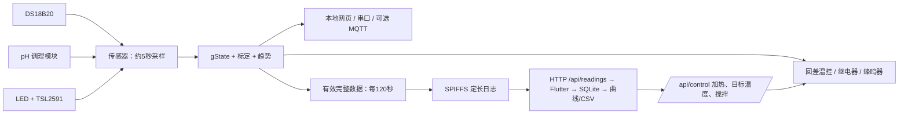

# 固件与 App 的对接说明

## 一、软件结构

| 层 | App 文件 | 作用 |
|---|---|---|
| 页面 | `pages/home_page.dart`、`project_detail_page.dart`、`device_page.dart` | 批次管理、曲线、控制、设备连接 |
| 批次业务 | `services/fermenter_controller.dart` | 仿真与设备数据、实验时间轴、控制状态、收获判断 |
| 设备管理 | `services/device_manager.dart` | 连接、绑定批次、同步、自动下发控制 |
| 同步 | `device/device_sync_service.dart` | 校时 → 分页拉取 → 落库 → 回收 |
| 传输 | `device/http_device_client.dart` | 设备本地 HTTP API（Basic Auth） |
| 数据模型 | `device/device_client.dart` | 状态/读数/分页结构 |

设备端对应实现：

- `src/modules/network/network_manager.cpp`：网页与 `/api/*`
- `src/modules/log/log_store.cpp`：双文件定长日志（20 字节/条）
- `src/modules/log/record_format.h`：日志记录编码与 CRC
- `src/app/fermenter_app.cpp`：5 秒采样 + 120 秒记录

## 二、数据流



## 三、HTTP 接口

所有接口使用 HTTP Basic Auth：用户名 `admin`，密码为设备启动时打印的
`webpass`（同时也是配置热点密码）。成功返回 2xx + JSON；失败返回
`{"error":"..."}`，401 表示密码错误。

| 方法 | 路径 | 说明 |
|---|---|---|
| GET | `/api/status` | 设备状态与日志游标 |
| GET | `/api/readings?since=<seq>&limit=<n>` | 按序号读取日志，`since` 含端点，`limit` 上限 200（默认 60） |
| POST | `/api/readings/commit` | 表单 `last=<seq>`，回收该序号及以前 |
| POST | `/api/control` | 表单 `target`、`heater`，可选 `stirrer`、`rpm` |
| POST | `/api/time` | 表单 `now=<Unix 秒>`，手机校时 |
| POST | `/api/wifi` | 表单 `ssid`、`password`，让设备接入路由器 |
| POST | `/api/calibrate`、`/api/ph/calibrate` 等 | 网页标定接口 |

### `/api/status` 主要字段

| 字段 | 含义 |
|---|---|
| `apiVersion` | 接口版本，当前为 `1`；App 用它判断固件是否支持同步 |
| `firmware` | 形如 `1.1.0` |
| `deviceId` | Wi-Fi MAC（无冒号），用于区分板子 |
| `oldestSeq` / `nextSeq` / `recordCount` / `logCapacity` / `logReady` | 日志范围与状态 |
| `sampleIntervalS` | 记录周期（秒），App 用它换算时间轴 |
| `tempC` / `ph` / `odProxy` / `slopePerMin` | 当前读数；无效时为 `null` |
| `heaterEnabled` / `heaterOn` / `targetTempC` | 温控状态 |
| `stirrerSupported` / `stirrerOn` / `stirrerRpm` | 搅拌（开环 PWM，未接线时为 `false`） |
| `alarm` | 下降趋势报警 |
| `staIp` / `apIp` | 路由器地址 / 热点地址 |

### `/api/readings` 响应

```json
{
  "oldest": 120, "next": 138, "count": 18, "since": 120,
  "records": [
    {"seq": 120, "timestamp": 1761000000, "tempC": 30.42, "ph": 7.05, "od": 0.412, "batteryMv": 0}
  ],
  "returned": 1, "hasMore": true
}
```

`timestamp` 为 Unix 秒；设备未校时时为 `0`，App 用手机时间占位。
`od` 实际是相对光衰减（沿用 App 曲线位），**不是已标定的 OD600**。
`batteryMv` 恒为 0：这版硬件没有电池采样电路。

### `/api/control`

`stirrer`、`rpm` 是可选字段：不传就不改动当前搅拌状态（网页温控表单就不带
它们）。目标温度须在 5 °C 与软件过温上限之间；转速须在 100–300 rpm。

## 四、同步与存储规则

1. App 先 `POST /api/time` 校时，再按本地记录的游标请求
   `/api/readings?since=<cursor>`。
2. 设备把 `since` 夹到 `[oldest, next]`，一次最多返回 `limit` 条。
3. App 逐页落库；只有整轮全部落库后才调用 `/api/readings/commit`。
   中途失败不回收，设备上的数据还在，下次重来。
4. 同步开始时的 `next` 作为上界：同步期间新写入的记录留给下一次，避免乱序。
5. 日志满 2000 条后停止新增记录，而不是覆盖未同步数据。
6. SPIFFS 使用 A/B 两个版本文件：重写时先复制保留记录，最后写入带 CRC 的头，
   再切换活动文件；启动时扫描 CRC 与连续序号。空日志仍保存下一序号，正常重启
   或回收都不回退序号。
7. 不自动格式化文件系统，不主动清空 NVS；挂载失败保留现场。`LOG_FORMAT` 是
   用户通过串口执行的显式初始化/清空命令。

## 五、使用边界

1. App 固定 `deviceSampleIntervalSeconds = 120`，所以固件保留 5 秒本地温控与
   网页刷新，另外每 120 秒记录一条供 App 同步。App 的收获检测窗口按 120 秒
   数据运行，与固件 5 秒蜂鸣器报警的时间尺度不同，两者不会同时触发。
2. 记录没有无效位：缺失温度、未标定 pH、未标定光路时会暂缓记录，恢复后序号
   继续连续。App 的 `seq × 120` 横轴无法体现停机时长，应参考记录的绝对时间戳。
3. App 没有 pH/光学标定接口，也没有控制成功回执。请以网页或串口日志为准。
4. 沿用单设备、单批次同步游标逻辑。请把一台设备的连续日志绑定到同一个真实
   批次，不要把演示/仿真记录混入同一批次。
5. 接口使用 HTTP + Basic Auth，适用于受控实验局域网；不要直接暴露到公网。

## 六、构建与验证范围

手机端：`flutter analyze` + `flutter test`。固件：Arduino IDE 编译；没有连接
实物进行传感器精度、长期存储或温控效果测量。
