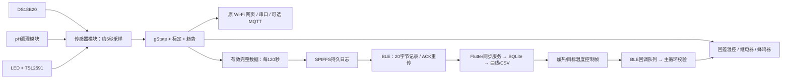

# 项目思路与固件适配说明

## 一、软件实际结构

| 层 | 现有 App 文件 | 作用 |
|---|---|---|
| 页面 | `pages/home_page.dart`、`project_detail_page.dart`、`device_page.dart` | 批次管理、曲线、控制、设备连接 |
| 批次业务 | `services/fermenter_controller.dart` | 仿真与真实设备数据、实验时间轴、控制状态、收获判断 |
| 蓝牙管理 | `services/ble_device_manager.dart` | 扫描连接、绑定批次、同步、自动下发控制 |
| 同步 | `ble/ble_sync_service.dart` | 校时 → 请求序号 → 数据落库 → ACK → 同步结束 → COMMIT |
| 协议 | `ble/ble_protocol.dart` | UUID、20 字节帧、CRC、控制与状态编码 |
| 平台通信 | `ble/reactive_ble_client.dart` | flutter_reactive_ble 与 Android BLE |
| 数据库/导出 | `database/`、`services/csv_export_service.dart` | SQLite 保存与 CSV 分享 |

这个 App 是 BLE 本地实验管理软件；MQTT 不是它目前的设备接口。原固件示例还存在 GPIO5 搅拌/测量 LED 冲突、与真实标定方式不一致、缺失的协议文档链接等问题。本次以真实采集模块为基础，按 App 已实现的字节协议增加 BLE 接口。

## 二、适配后的数据流

BLE 回调只入队，传感器状态、执行器、NVS 和日志操作均由主循环处理，避免蓝牙任务与采样模块同时修改状态。通知先检查客户端是否订阅。断线后重新广播；旧会话命令不会带入新连接。

## 三、协议对照

服务 UUID：`4fafc201-1fb5-459e-8fcc-c5c9c331914b`。

| 特征 | 属性 | 内容 |
|---|---|---|
| `0000a101-0000-1000-8000-00805f9b34fb` | Read | 16字节：版本、蓝牙MAC、电池、日志容量 |
| `0000a102-0000-1000-8000-00805f9b34fb` | Notify | 20字节传感器记录 |
| `0000a103-0000-1000-8000-00805f9b34fb` | Write with response | 同步、ACK、校时、COMMIT、控制 |
| `0000a104-0000-1000-8000-00805f9b34fb` | Notify | 同步结束、错误、日志范围 |

记录采用小端序：magic `A5`、版本 `01`、seq(u32)、Unix秒(u32)、温度×100(i16)、pH×100(i16)、光学值×1000(i16)、电池mV(u16)、CRC16(u16)。CRC为 CCITT-FALSE，覆盖前18字节，初值FFFF、多项式1021。固件版本号为1.1.0，保持v1帧布局。

没有电池测量电路，电池字段为0，不能解释为已测得电池电压。光学字段沿用 App 的 `od` 名称，但实际为 CH0 明暗差分计算的相对光衰减；传输时负值夹到0，以兼容 App，尚未标定为 OD600。网页和串口保留原测量语义。

命令：`01+nextSeq` 从该序号开始；`02+seq` 确认已落库；`03+Unix秒` 校时；`04+lastSeq` 请求回收；`10+flags+rpm(u16)+target×10(u16)` 设置控制。bit0搅拌、bit1自动加热。状态为81同步结束、82错误、84日志状态。

## 四、同步与存储规则

- 一次发送一条，等对应序号 ACK 才前进；未来序号或无对应待发帧的 ACK 不会授权回收。超时重发两次，再报错停止，保留数据等待重连。
- 同步开始固定一个历史快照终点，收到最后一条 ACK 后才发 SYNC_END；随后继续实时发送新日志，避免历史与实时帧乱序。
- 请求从非最早序号开始时，会补发前一条作为重复记录。App 已有重复处理逻辑，会再次 ACK，因此无新数据的同步也能安全证明 COMMIT 边界。
- COMMIT 不能超过本连接实际收到的 ACK 水位，不接受FFFFFFFF。日志满时不覆盖未确认数据。
- SPIFFS 使用A/B两个版本文件，重写时先复制保留记录，最后写入带CRC的头，再切换活动文件；启动扫描CRC及连续序号。空日志仍保存下一序号，正常重启/回收不回退序号。
- 不自动格式化文件系统，不主动清空NVS；挂载失败保留现场。`BLE_FORMAT` 是用户通过串口执行的显式初始化/清空命令。
- 手机校时前时间戳为0，沿用App的手机时间占位逻辑；不把断电前的旧时间冒充当前时间。重连后App会再次校时。

## 五、保持原 App 时必须理解的边界

1. App 固定 `deviceSampleIntervalSeconds=120`，所以保留5秒本地温控，另外每120秒记录BLE数据。App收获检测的窗口也按120秒数据运行，和固件5秒蜂鸣器报警的时间尺度不同，不能声称两边报警同时触发。
2. v1没有无效位；缺失温度、未标定pH、未标定光路等情况会暂缓BLE记录。恢复后序号连续，但App的 `seq×120` 横轴无法体现停机和无效期间的真实时长，应参考记录的绝对时间戳。需要精确缺测曲线时应升级App的数据模型与协议。
3. App没有pH/光学标定指令，没有控制状态读回/成功回执，也没有设备报警位。固件错误会发82状态帧，但App在非同步阶段目前只在内部记录 `lastFailure`，因此界面控件变化不代表设备接受了控制。请核对串口日志或本地网页的真实状态；默认搅拌关闭、目标5℃至小于39.5℃。
4. 沿用当前App的单设备、单批次同步游标逻辑。请把一台设备连续日志绑定到同一真实批次，不要把演示/仿真记录混入同一批次；新批次的seq并不会自动归零。切换设备或多批次分段管理需要App补充设备ID与批次起始序号，不能只改固件解决。
5. App没有配对鉴权交互。本BLE版本兼容其现有连接流程，附近可连接设备的客户端能够发送控制指令；适用于受控实验环境，开放部署前需在App和固件双方增加认证。
6. 可选搅拌仅提供开环PWM映射，默认禁用；没有硬件反馈时不报告“实际RPM”。目前没有主动制冷、自动酸碱添加或pH温度补偿。

## 六、构建与验证范围

本次不修改手机App，不增加或运行测试。Arduino构建结果单独记录在 `BUILD_RECORD.md`；没有连接实物进行蓝牙同步、传感器精度、长期存储或温控效果测量。
